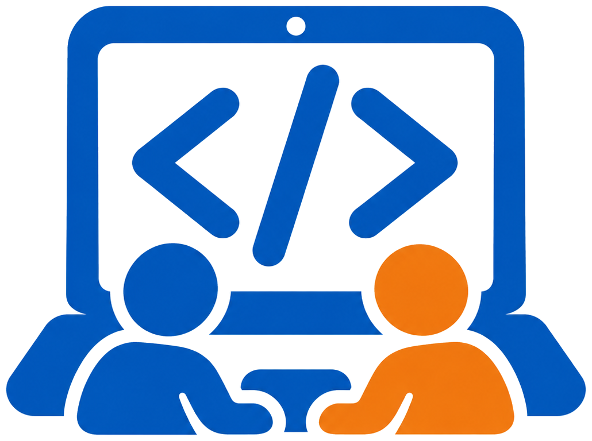

# Java デスクトップアプリ課題

> このリポジトリは自動生成されています。直接 push しても、次回の更新で上書きされますのでご注意ください。

Java SE 25 と Swing で作るデスクトップアプリの課題集です。10個のテーマから1つを選び、2〜3日で完成させます。テーマごとの「必須要件」をすべて満たせば合格です。「拡張要件」は早く終わった人向けの任意課題です。

## テーマ一覧

| No. | テーマ | 難易度 | フォルダ | 実行構成の名前 |
| --- | --- | --- | --- | --- |
| 1 | [じゃんけんゲーム](theme01-janken/README.md) | ★ | `theme01-janken` | テーマ01 じゃんけん |
| 2 | [数当てゲーム](theme02-number-guess/README.md) | ★ | `theme02-number-guess` | テーマ02 数当てゲーム |
| 3 | [電卓](theme03-calculator/README.md) | ★★ | `theme03-calculator` | テーマ03 電卓 |
| 4 | [ポモドーロタイマー](theme04-pomodoro/README.md) | ★★ | `theme04-pomodoro` | テーマ04 ポモドーロタイマー |
| 5 | [クイズアプリ](theme05-quiz/README.md) | ★★ | `theme05-quiz` | テーマ05 単語帳・クイズ |
| 6 | [ToDoリスト](theme06-todo/README.md) | ★★ | `theme06-todo` | テーマ06 ToDoリスト |
| 7 | [簡易メモ帳](theme07-memo/README.md) | ★★ | `theme07-memo` | テーマ07 簡易メモ帳 |
| 8 | [三目並べ](theme08-tictactoe/README.md) | ★★★ | `theme08-tictactoe` | テーマ08 三目並べ |
| 9 | [家計簿](theme09-kakeibo/README.md) | ★★★ | `theme09-kakeibo` | テーマ09 家計簿 |
| 10 | [簡易お絵描き](theme10-paint/README.md) | ★★★ | `theme10-paint` | テーマ10 簡易お絵描き |

テーマ名をクリックすると、そのテーマの要求仕様書が開きます。

## 開発環境

| 項目 | 内容 |
| --- | --- |
| 言語 | Java SE 25 以降 |
| IDE | IntelliJ IDEA |
| GUIライブラリ | Swing（JDK標準。追加ライブラリは使わない） |
| ビルド | IntelliJの標準プロジェクト（Maven・Gradleは使わない） |
| 文字コード | UTF-8 |

## 準備：プロジェクトをクローンする

1. IntelliJ IDEA を起動する
2. ようこそ画面の「VCS から取得」を押す（プロジェクトを開いている場合は、メニューの「ファイル」→「新規」→「バージョン管理からのプロジェクト...」）
3. 「URL」欄に、講師から伝えられたリポジトリのURLを貼り付ける
4. 「ディレクトリー」欄で保存先を確認し、「クローン」を押す
5. 「このプロジェクトを信頼しますか？」と聞かれたら「プロジェクトを信頼」を押す

IntelliJのバージョンによって、ボタンやメニューの名前が少し違うことがあります。

## 準備：JDKを設定する

画面の上に「プロジェクト JDK が定義されていません」と表示された場合や、実行できない場合は、次の手順でJDKを設定します。

1. メニューの「ファイル」→「プロジェクト構造...」を開く
2. 左側の「プロジェクト」を選ぶ
3. 「SDK」の一覧からバージョン25のJDKを選ぶ。一覧に無い場合は「JDK のダウンロード...」から、バージョン25を選んでダウンロードする
4. 「言語レベル」が「SDK のデフォルト」または 25 になっていることを確認し、「OK」を押す

## 実行方法

1. 画面右上の実行構成の一覧から、自分のテーマ（例：「テーマ01 じゃんけん」）を選ぶ
2. 緑の実行ボタン（▶）を押す

最初は、タイトルだけが入った空のウィンドウが表示されます。各テーマの `MainFrame.java` から作り始めてください。

## 全テーマ共通の要件

| ID | 要件 |
| --- | --- |
| C-01 | ウィンドウのタイトルバーにアプリ名を表示する |
| C-02 | ウィンドウの×ボタンでアプリが終了する |
| C-03 | 画面を作るクラスと、計算・判定などの処理を行うクラスを分ける |
| C-04 | 不正な入力や操作をしても、アプリが強制終了しない |
| C-05 | クラス名・変数名は内容がわかる英単語で付ける |
| C-06 | 各クラスの先頭に、そのクラスの役割をコメントで書く |

C-01とC-02は、スターターコードの段階で実装済みです。

## 開発期間の目安

1. 1日目：画面のスケッチ、部品の配置、ボタンを押すと反応するところまで
2. 2日目：必須要件の機能を実装する
3. 3日目：入力チェック・動作確認・拡張要件・発表

## 提出物

- 自分のテーマのフォルダ一式
- 画面のスクリーンショット（主要な画面すべて）
- 実装した機能のチェックリスト（各テーマの「受け入れ基準」に印を付けたもの）
